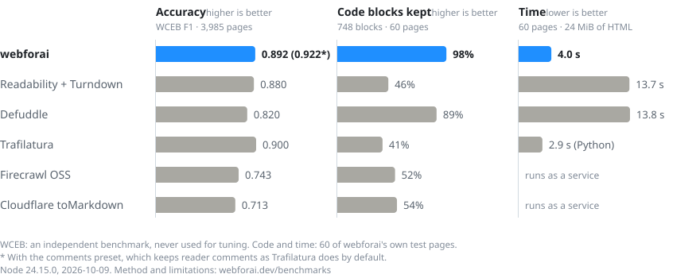

<br/>

<p align="center">
  <a href="https://webforai.dev">
    <picture>
      <source media="(prefers-color-scheme: dark)" srcset="site/docs/public/images/readme-logo-dark.svg">
      
    </picture>
  </a>
</p>

<h3 align="center">Any HTML to the cleanest Markdown, for humans and AI agents.</h3>

<p align="center">
  <b>Best quality</b> · <b>Most token-efficient</b> · <b>Near-top speed</b> · <b>Pure TypeScript</b>
</p>

<p align="center">
  <b>Reader mode</b> extracts the main content of a page, like Mozilla Readability, with the best
  quality of the converters we benchmarked. <b>Agent mode</b> adds only the links an AI agent needs
  to explore the site, for about half the tokens of converting the whole page. Both are measured
  against other converters <a href="#benchmarks">below</a>.
</p>

<p align="center">
  <a href="https://www.npmjs.com/package/webforai"></a>
  <a href="https://www.npmjs.com/package/webforai"></a>
  <a href="https://github.com/inaridiy/webforai/actions/workflows/ci.yaml"></a>
  <a href="https://github.com/inaridiy/webforai/blob/main/LICENSE"></a>
</p>

<p align="center">
  <a href="https://webforai.dev/#demo"><b>Try it live</b></a> ·
  <a href="https://webforai.dev/getting-started"><b>Docs</b></a> ·
  <a href="https://webforai.dev/benchmarks"><b>Benchmarks</b></a> ·
  <a href="https://webforai.dev/cli"><b>CLI</b></a> ·
  <a href="https://platform.webforai.dev"><b>Hosted API</b></a>
</p>

<br/>

## Quick start

```bash
npm i webforai
```

```ts
import { htmlToMarkdown, presetExtractors } from "webforai";

const url = "https://vite.dev/guide/env-and-mode";
const html = await (await fetch(url)).text();

const markdown = htmlToMarkdown(html, { url }); // Reader mode: the main content
const forAgents = htmlToMarkdown(html, { url, extractors: presetExtractors("agent") }); // Agent mode: + the links
```

<details>
<summary><b>What you get</b> — <code>forAgents</code> for that page, abridged</summary>
<br/>

````md
# Env Variables and Modes

Vite exposes certain constants under the special `import.meta.env` object. These constants are
defined as global variables during dev and statically replaced at build time to make tree-shaking
effective.

```js
if (import.meta.env.DEV) {
  // code inside here will be tree-shaken in production builds
  console.log('Dev mode')
}
```

## Built-in Constants

- **`import.meta.env.MODE`**: {string} the [mode](#modes) the app is running in.
- **`import.meta.env.BASE_URL`**: {string} the base url the app is being served from. …

…

## Links

### Pagination

- [Previous page Deploying a Static Site](https://vite.dev/guide/static-deploy)
- [Next page Server-Side Rendering (SSR)](https://vite.dev/guide/ssr)

### Section navigation

- [Getting Started](https://vite.dev/guide/)
- [Features](https://vite.dev/guide/features)
- [Building for Production](https://vite.dev/guide/build)
- …
````

</details>

- **Reader mode** (default) returns the article alone, up to `## Links`: for reading, summarising,
  RAG and embeddings.
- **Agent mode** adds the `## Links` section — related, pagination, section and site navigation,
  breadcrumbs — so an agent can decide which page to open next.
- Code blocks keep their language, tables stay GFM tables, KaTeX and MathJax become LaTeX, and
  lazy-loaded images come through. Page metadata (title, author, published, …) comes from
  `htmlToMarkdownWithMetadata` or as YAML front matter with `frontmatter: true`.
- The snippet runs as-is in Node.js, Cloudflare Workers and browsers: the library uses no Node.js
  built-ins and fetches nothing itself. Browser loaders (Playwright, Puppeteer) are optional.

From the shell: `npx webforai-cli <url>`, with `--extractor agent` for agent mode. For pages that
need a browser or a proxy, use the [hosted API](#ways-to-use). With nothing installed,
`https://platform.webforai.dev/https://example.com/article` returns that page as Markdown (a
rate-limited demo without a key). Coding agents learn the CLI from its Agent Skill:
`npx skills add inaridiy/webforai`, or as a plugin in Claude Code
(`/plugin install webforai --marketplace inaridiy/webforai`), Codex
(`codex plugin marketplace add inaridiy/webforai`) and pi (`pi install npm:webforai-cli`).

## Benchmarks

### Reader mode: main content

<picture>
  <source media="(prefers-color-scheme: dark)" srcset="site/docs/public/images/benchmark-dark.svg">
  
</picture>

F1 on [WCEB](https://github.com/chatnoir-eu/web-content-extraction-benchmark), 3,985 pages:
webforai **0.923** (keeping reader comments, as Trafilatura does), Trafilatura 0.900,
Readability + Turndown 0.880, Defuddle 0.820. webforai keeps 98% of code blocks;
Readability + Turndown keeps 46%. It converts 60 pages in 4.0 s where Readability + Turndown
takes 13.7 s. [Method and configurations →](https://webforai.dev/benchmarks)

### Agent mode: following links

290 tasks ask a model to follow a related or next article to answer a question. How often it
picks the right link, and how many tokens it was given:

| Output given to the model | Right link chosen (Haiku 5.5 / Sonnet 5.5) | Median tokens |
| --- | ---: | ---: |
| webforai, agent mode | 93.8% / 94.1% | **2,426** |
| Whole page, Turndown | 92.9% / 94.8% | 4,533 |
| Whole page, node-html-markdown | 92.6% / 94.5% | 4,350 |

Same accuracy, about half the tokens.
[Method and task list →](https://webforai.dev/benchmarks#following-links-agent-mode)

## Ways to use

| | Install | Use it for |
| --- | --- | --- |
| **Library** — [`webforai`](https://www.npmjs.com/package/webforai) | `npm i webforai` | HTML you already have, in your own code. Node.js (ESM and CommonJS), Cloudflare Workers and browsers; ~300 KB gzipped in a Worker. [Getting started →](https://webforai.dev/getting-started) |
| **CLI** — [`webforai-cli`](https://www.npmjs.com/package/webforai-cli) | `npx webforai-cli <url>` | The shell, scripts and AI agents (it ships an Agent Skill). [CLI →](https://webforai.dev/cli) |
| **Hosted API** — [webforai platform](https://platform.webforai.dev) | API key | JavaScript rendering, proxies, and crawling whole sites to Markdown and `llms.txt`. 1,000 free credits a month. [Platform docs →](https://webforai.dev/platform) |

The library fetches nothing by itself: pass it HTML, or load pages with `webforai/loaders/fetch`,
`webforai/loaders/playwright` (add `playwright-core`) or the
[other loaders](https://webforai.dev/docs/loaders).

## Contributing

Issues and pull requests are welcome. `pnpm install`, then `pnpm run test --run` and
`pnpm build`; [AGENTS.md](AGENTS.md) describes the layout of the repository and its conventions.
The library ([`packages/webforai`](packages/webforai)), the CLI ([`packages/cli`](packages/cli))
and the platform ([`apps/platform`](apps/platform)) all live here, and release notes are in the
[CHANGELOG](packages/webforai/CHANGELOG.md).

## Support

- [GitHub Sponsors](https://github.com/sponsors/inaridiy)
- [@inaridiy on X](https://x.com/inaridiy)

## License

[Apache 2.0](LICENSE)
